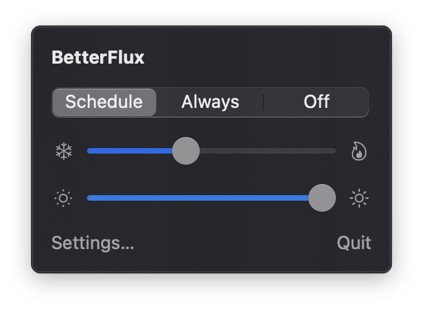

# BetterFlux

A small macOS menu bar app that warms your screen at night and dims it further than the hardware minimum allows.

- **Warmth** — Schedule (warms up in the evening, cools down in the morning, with a gradual transition), Always, or Off.
- **Extra dimming** — go below the lowest built-in brightness, down to 5%.
- **Hotkeys** — ⌃⌥⌘↓ dim, ⌃⌥⌘↑ brighten, ⌃⌥⌘0 back to full brightness.
- Works on every connected display and keeps each display's ColorSync calibration. Turning warmth off also resets the dimming.

<p align="center"></p>

## Install

1. Download **[BetterFlux.zip](https://github.com/capheproject/BetterFlux/releases/latest/download/BetterFlux.zip)** from the [latest release](https://github.com/capheproject/BetterFlux/releases/latest), unzip it, and drag **BetterFlux.app** into your Applications folder.
2. Open it. The app is free and open source but not notarized by Apple, so the first time macOS stops it with a message like *“Apple could not verify BetterFlux is free of malware”*. Click **Done**, then allow it one of these ways:
   - Open **System Settings › Privacy & Security**, scroll down to the message about BetterFlux, click **Open Anyway**, and confirm with your password or Touch ID.
   - Or run this in Terminal:
     ```sh
     xattr -dr com.apple.quarantine /Applications/BetterFlux.app
     ```

   You only need to do this once. After that it opens like any other app.

Runs on Apple silicon and Intel Macs with macOS 15 or later.

## Build from source

```sh
./build.sh            # builds build/BetterFlux.app
./build.sh --install  # also copies it to /Applications
```

## License

MIT
